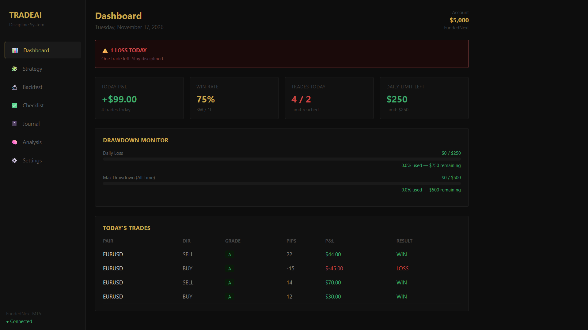
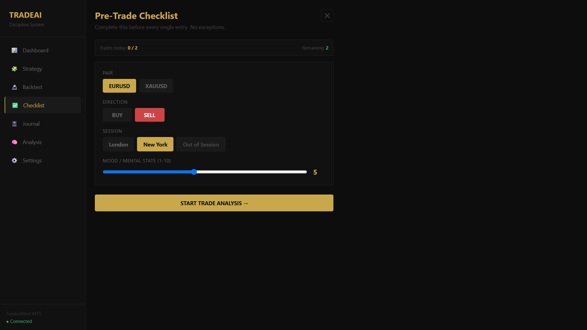
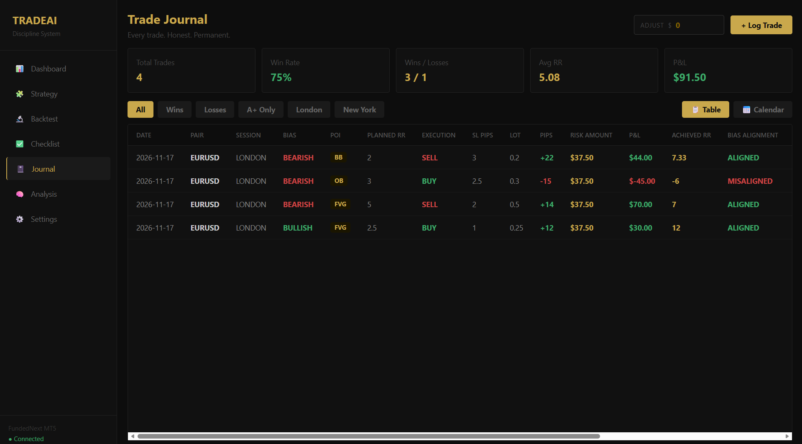
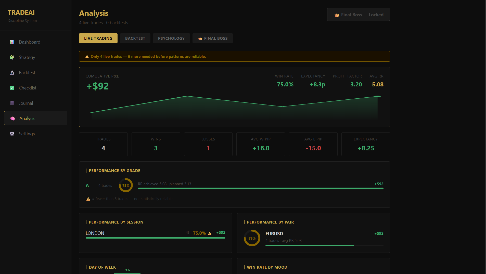
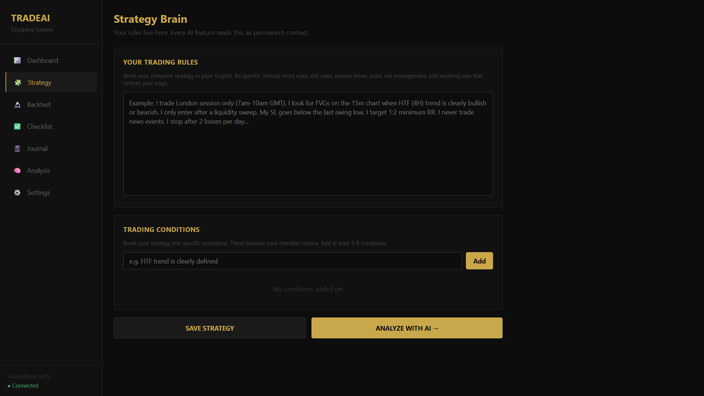
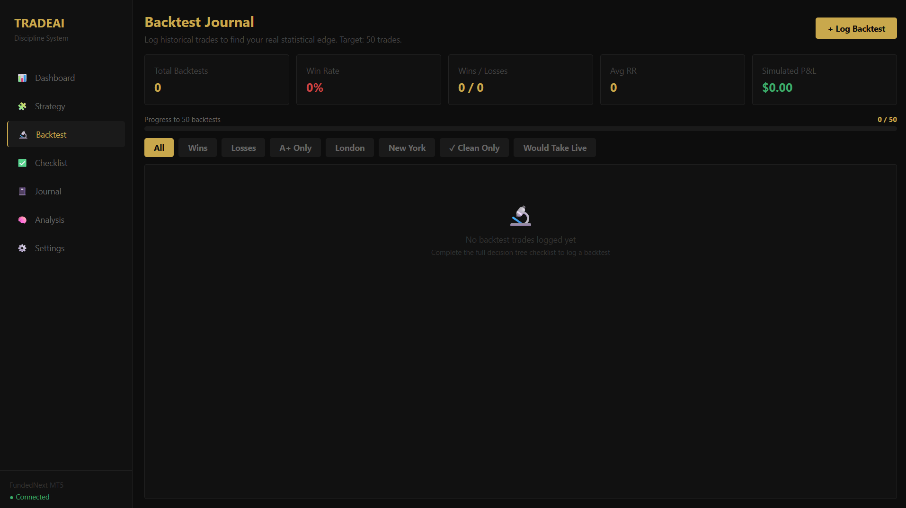
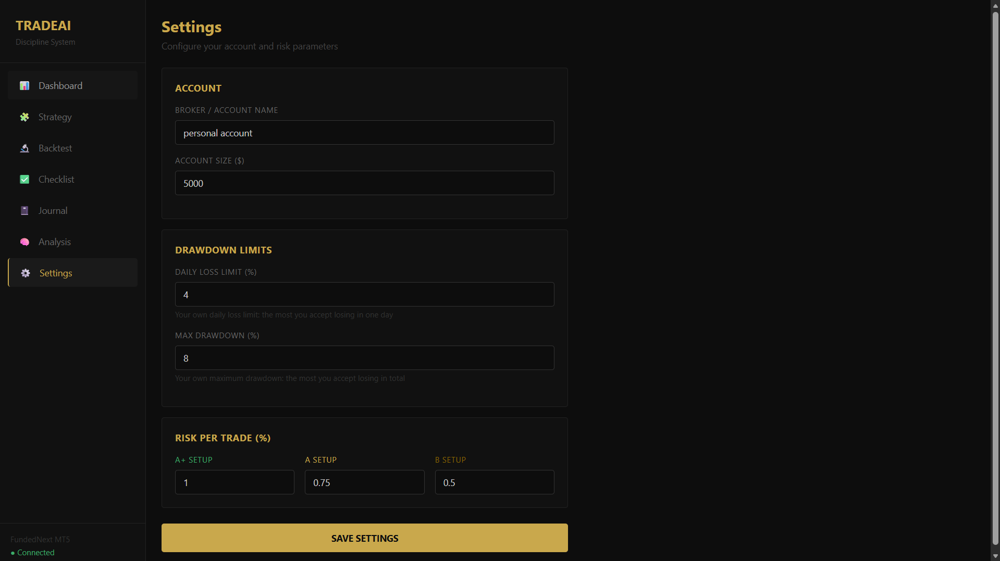

# TradeAI

A full-stack trading journal and discipline tool. It logs trades, grades each setup with a fixed rule set, enforces daily risk limits, and uses an LLM to write analysis reports from your own trade data.

## Features
- Trade journal: log live and backtest trades with P&L, broker charges and notes
- Rule-based grading: every trade is graded by deterministic JavaScript logic. The AI only writes the explanation and cannot change the grade
- Tilt management: daily trade limit, session lock after consecutive wins or losses, and a streak mode after repeated losses
- Dashboard: P&L, daily loss and drawdown monitor
- AI analysis report: an LLM summarises patterns from stored trade data

## Tech stack
- Frontend: React, Vite
- Backend: Node.js, Express
- Database: SQLite (better-sqlite3)
- AI: Groq API

## Run locally
1. Clone the repo and open the folder.
2. Backend, in a terminal:

        cd backend
        npm install
        copy .env.example .env

   Open .env, add your own Groq API key, then start the server:

        node server.js

3. Frontend, in a second terminal:

        cd frontend
        npm install
        npm run dev

4. Open http://localhost:5173

The database file is created locally on first run.

## Environment variables
See backend/.env.example. Never commit a real .env file. The model name is set with GROQ_MODEL, so it can be changed without touching the code.

## Screenshots
These screenshots use demo data, not real trades.

### Dashboard

### Pre-trade checklist

### Journal

### Analysis

### Strategy

### Backtest

### Settings

## Disclaimer
TradeAI is a personal learning project. It records trades that you enter yourself, applies fixed rules to grade them, and uses an LLM to write summaries. It does not place trades, predict markets or give financial advice.

## Status
Personal project, still in development.
